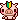
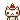

<table class="tg"><!-- table generated from https://www.tablesgenerator.com/html_tables#, I tweaked the styling -->
    <tbody><!-- script source: https://bechnokid.neocities.org/resources/tut_statuscafefeed
        <tr>
            <td class="tg-0pky" colspan="3">
                

                
            </td>
        </tr>-->
        <tr>
            <td class="tg-0pky noext" colspan="3">
                
            </td>
        </tr>
        <tr>
            <th class="tg-0pky" title="date">🗓️ 26.11.01</th>
            <th class="tg-0pky" title="digitally playing">💻 <a target="_blank" href="http://dragcave.net/">Dragon Cave</a></th>
            <th class="tg-0pky" title="drinking">🥛 protein milk</th>
        </tr>
        <tr>
            <td class="tg-0pky" title="time">⌚ 9:09am</td>
            <td class="tg-0pky" title="feeling">😴 sleepy</td>
            <td class="tg-0pky" title="eating">🌶️ vegan chili</td>
        </tr>
        <tr>
            <td class="tg-0pky" title="listening to" colspan="3">🎵 <a target="_blank" href="https://www.youtube.com/watch?v=-vCdmd99Cx8">Good Life by Sammy Rae & The Friends</a></td>
        </tr>
        <tr>
            <td class="tg-0pky" title="watching" colspan="3">📺 Chihayafuru (anime, subbed)</td>
        </tr>
        <tr>
            <td class="tg-0pky" title="reading" colspan="3">📖 <a target="_blank" href="https://en.wikipedia.org/wiki/Samhain">History of Samhain on Wikipedia</a></td>
        </tr>
    </tbody>
</table>
<h1>My Now Page</h1>

    This page is intended for casual, personal updates compared to my blog posts. It is inspired by <a target="_blank" href="https://cepheus.neocities.org/">Cepheus's <i>atm table</i></a>, <a target="_blank" href="https://slashpages.net/#now">now slash pages</a>, and level 10 life.

<h2>Last Update: November 1, 2026</h2>

    

        

            

                 <b>Friends and Family</b>
                 
                Finally made a discord for all my friends from different realms of my life to come hang out digitally. I was so nervous no one would join or post, but that's not the case. I love that I'm seeing more of my friends now, especially since I want to give up my IG where I connect with a lot of them due to the Gen AI T&Cs they're rolling out.
            

        

        

            

                 <b>Personal development</b>
                 
                I'm so happy I decided to take the plunge and enroll in Spanish classes with my friend. We're both at the same level of Spanish, so it's been motivating and fun to have a friend in virtual classes through Lingoda. I hope that I'll be more proficient in Spanish the next time ICE hits our city hard so that I can better educate my neighbors on their rights.
            

        

        

            

                 <b>Spirituality</b>
                 
                I don't really feel as bored as I have been in the past primarily because I get a sense of fulfillment from taking Spanish classes every other day. I feel accomplished and happy that I'm doing something in service of others while also bettering myself. I wouldn't all it equanimity per se, but I haven't been feeling like something's lacking lately. Even though I'm scared of committing myself to things, I think it's the antidote to boredom.
            

        

        

            

                 <b>Career</b>
                 
                I took on a short-term stretch project that didn't end up being a stretch at all. I was so anxious about it, but I wanted the extra pay. I'm so glad I did it because my anxiety was entirely unfounded, and I did a good enough job that I can be proud of myself.
            

        

        

            

                 <b>Fun and Recreation</b>
                 
                I've been slowing down on playing TTRPG one-shots primarily because I've tried so many systems now, and there aren't that many novel ones being offered locally. I've been focused more on knitting now that it's cooling off, and I have been debating creating a knitting vlogs to document my making process.
            

        

        

            

                 <b>Health and Fitness</b>
                 
                I finally took the plunge and started meeting with a dietician, which has done wonders for my gut health and energy. I've been tracking my food through the Cronometer app daily for about a month now, and it's been illuminating. I've completely changed my diet for the better, and my dietician has helped me aim for 110g protein and 30g of fiber while staying under 180g of carbs each day. It's been quite flexible and achievable for me.
            

        

        

            

                <b>What's In My Bag: Fall Edition</b>
                 
                📔 <a target="_blank" href="https://www.1101.com/store/techo/en/2026/pc/detail_cover/wb26_kitagishi/">Yumi Kitagishi Hobonichi Weeks</a>
                 
                ✒️ <a target="_blank" href="https://bungubox.shop/pages/originalfountainpenhistory#:~:text=The%20Tale%20of%20the%20Bamboo%20Cutter%20%2D%20Princess%20Kaguya.%E3%80%90October%202023%E3%80%91JPY42%2C000%EF%BD%9E">Princess Kaguya Sailor PGS pen</a>
                 
                🐣 <a href="/tamagotchi/">Sanrio Tamagotchi Meets</a>
                 
                🛍️ <a target="_blank" href="https://www.moomin.co.jp/news/products/93782">Moomin Shupatto reusable bag</a>
                 
                💧 Darling Daisy Owala bottle
                 
                🎲 <a href="/ttrpgs/">Polyhedral set of math rocks</a>
                 
                🧶 <a target="_blank" href="https://www.ravelry.com/projects/toritried/alpine-bloom-4">Alpine Bloom sweater WIP</a>
            

        

        

            

                <b>Mid-term Goals</b>
                 
                🗣️ improve my Spanish level
                 
                🧶 knit a new fall sweater
                 
                🚲 200 lifetime peloton rides
            

        

        

            

                <b>Long-term Goals</b>
                 
                💻 learn JavaScript
                 
                💰 sell some tamagotchi
                 
                🤡 take an improv class
                 
                📚 <a href="/books/">read 20 books in 2026</a>
                 
                🎨 practice pixel art more
                 
                🌱 write up more vegan recipes
            

        

    

